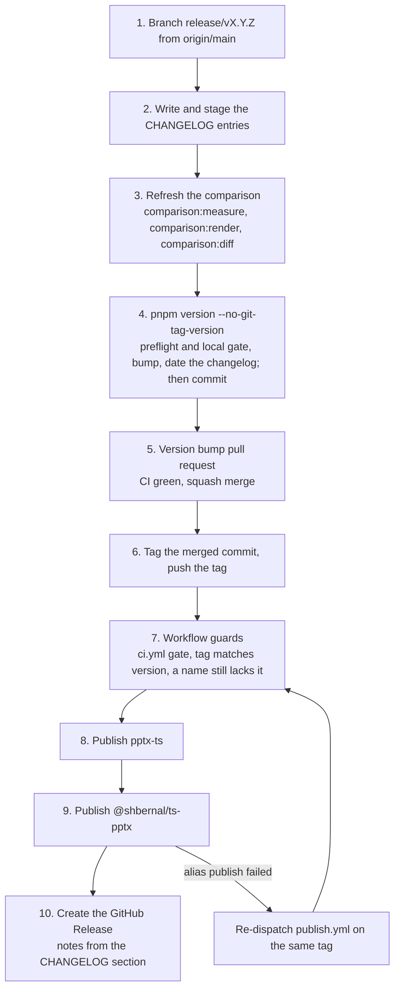

# Release workflow

Every release ships two packages with the same content. `pptx-ts` is the canonical name, and
`@shbernal/ts-pptx` is the scoped alias the project published under first. npm has no redirect, so
the alias is a second publish of the same build under a second name. `scripts/alias-package.mjs`
stages that copy: the `name` differs, the README gains a banner naming `pptx-ts`, and the `scripts`
block is dropped. You never bump, tag or stage the alias by hand.

`main` is protected and takes changes only through pull requests, so a release is two pushes: a
version bump pull request, squash-merged like any other, and then the `vX.Y.Z` tag on the commit
it merged as. `.github/workflows/publish.yml` publishes both names when that tag is pushed, then
creates the GitHub Release for it. It also
publishes a prerelease of every push to `main` under the `next` dist-tag; see
[The `next` channel](#the-next-channel). The
[`release-publish` skill](https://github.com/shbernal/pptx-ts/blob/main/.agents/skills/release-publish/SKILL.md)
has the commands for each step. This page says why the steps are shaped the way they are.

## The release



## Prerequisites

- Each name, `pptx-ts` and `@shbernal/ts-pptx`, has its own trusted publisher on npm, because npm
  exchanges the OIDC token per package. Both name repository `shbernal/pptx-ts`, workflow
  `publish.yml`, environment `npm-publish`, and the action `npm publish`.
- The GitHub environment `npm-publish` exists, and its deployment policy allows only tags matching
  `v*` (a tag push runs on the tag) and the branch `main` (manual dispatch, and the
  `next` channel, whose `workflow_run` event runs on the default branch). A run from any other ref
  fails at the publish job.
- `package.json#repository.url` points at `shbernal/pptx-ts`.
- No `NPM_TOKEN` secret. The workflow authenticates through OIDC with `id-token: write`, and passes
  `--provenance` so provenance stays required if npm's default changes.

Nobody runs `npm publish` locally for a release, including to repair one. The retry path is the
workflow.

## Refreshing the comparison

The pptxgenjs comparison is refreshed first, so its numbers land in the release commit beside the
changelog entry. `comparison:measure` installs upstream pptxgenjs into a scratch directory, calls
the GitHub and npm APIs, and times both libraries for about a minute. That is why it is a release
step and not part of `verify`, which runs only `comparison:check` against the committed snapshot.
Leave the machine alone while it runs: a build in another window lands in the published timings.

`measure.mjs` refuses to write a snapshot with a hole in it. Never pass `--allow-unavailable` for a
release snapshot. A table missing rows because an API rate-limited is worse than a table one
release out of date, so re-run the fetch later instead.

### What to stop on in the snapshot diff

`pnpm run comparison:diff` (`scripts/comparison/diff.mjs`) compares the refreshed snapshot with the
committed one and exits 1 on any of the changes below, listing each. The release stops there until
someone has looked. A diff whose only changes are `generatedAt`, a download count and the timing
medians is the normal case and passes. A clock took the timings, so they move on every run, and a
few percent either way means nothing. It stops on these:

- **A coverage row that flipped**, in either direction, or one added or removed. A construct one library emits and the other
  does not is the substance of the page. A flip means a real capability moved, or a probe stopped
  measuring what it claims to.
- **A validity count that moved**, ours especially. The page states how many probe decks pass the
  schema oracle, and a release is the wrong moment to find that number went down.
- **An upstream version bump.** It re-dates every claim on the page and makes the two checks above
  worth a closer look.
- **A timing row that changed sign, or a `compression` ratio near 1.** The page's reading of the
  timing tables holds only while every compressed row favours us and every stored row favours
  upstream, and the rendered page drops it when that stops being true. A ratio near 1 (below 1.5
  in the script) is the louder signal: one library stopped compressing when asked, so its compressed
  column times something else.

## Bumping the version

`package.json` holds the version of record, and the workflow refuses to publish unless the tag
matches it. `VERSION` in `src/presentation.ts`, behind `pres.version`, is derived from it by
`scripts/sync-version.mjs`, never edited by hand. `pnpm run version:check` reports a drift and
`pnpm run version:sync` repairs it. `test/regression/api/public-accessors.test.ts` fails in `verify`
on a drift either way.

```bash
git fetch origin && git switch -c release/vX.Y.Z origin/main
# write and stage the changelog, refresh and stage the comparison
pnpm version minor --no-git-tag-version --no-git-checks
git add package.json && git commit -m 'chore(release): vX.Y.Z'
```

`pnpm version` runs the `preversion` lifecycle script, bumps `package.json` and runs the `version`
lifecycle script. The `version` script rewrites and stages the constant, and
`scripts/changelog.mjs --release` turns `## [Unreleased]` into
`## [X.Y.Z](…/releases/tag/vX.Y.Z) - YYYY-MM-DD` under a fresh empty `[Unreleased]`, so neither the
heading nor the date is typed by hand. The commit then holds `package.json`, the constant, the
changelog and the staged comparison refresh. Both flags are needed:

- `--no-git-tag-version`: without it pnpm also commits and tags. A tag on the branch commit would
  name a commit `main` never contains, because the squash merge makes a new one.
- `--no-git-checks`: pnpm refuses to run on an unclean tree (`ERR_PNPM_UNCLEAN_WORKING_TREE`), and
  the staged `CHANGELOG.md` counts. Waiving the check keeps the release to one commit.

The waiver covers everything, so `preversion` makes the checks a release needs instead.
`scripts/release-preflight.mjs` (`pnpm run release:preflight`) fails unless the branch is a
`release/*` branch at the same commit as `origin/main`, no tracked file has an unstaged change, nothing is staged but the
changelog and the comparison files, both the changelog and the snapshot are staged, `package.json`
still has the last tag's version, and `[Unreleased]` has entries. `preversion` then runs
`check:static` and `verify`, so the release commit already passed them. All of this
runs before pnpm changes anything, so a failure leaves the tree as it was. The heavier gates are
CI's: the publish workflow runs every `ci.yml` leg before it publishes, so they are not repeated
locally.

## The version bump pull request and the tag

Push the branch and open a pull request titled `chore(release): vX.Y.Z`. CI runs on it like on
any other change, and it merges with a squash once green. The merge publishes only the usual
`next` prerelease of the merged commit.

Then tag the merged commit and push the tag, which starts the publish:

```bash
git fetch origin main
git log -1 --format=%s origin/main    # chore(release): vX.Y.Z (#N)
git tag -a vX.Y.Z -m vX.Y.Z origin/main
git push origin vX.Y.Z
```

The tag goes on after the merge, never before: a tag pushed first would point at a branch commit
that `main` never contains. If another pull request merged on top of the release commit in the
meantime, tag the release commit by its hash. The workflow refuses a tag whose name does not match
`package.json#version`, so tagging the wrong commit fails before anything is published.

## What the workflow checks

- It runs only in `shbernal/pptx-ts`.
- Its `gate` job calls `ci.yml` through `workflow_call`, and `publish` needs `gate`, so every CI leg
  passes first. [What gates a release](testing.md#what-gates-a-release) lists them.
- `GITHUB_REF_TYPE` must be `tag`, so a manual dispatch from a branch fails.
- The tag must equal `v` plus `package.json#version`.
- It checks both names for the version and fails only when both already have it.
- It builds once, publishes `pptx-ts`, then stages the alias with
  `node scripts/alias-package.mjs --out .tmp/alias-package` and publishes that directory. Each
  publish step is skipped when its own name already has the version.
- Its `release` job then creates the GitHub Release for the tag, with
  `node scripts/changelog.mjs --notes vX.Y.Z` as the notes: the version's CHANGELOG section and a
  full-changelog link. It runs only after both publishes, so a Release never names a version npm
  lacks, and it is a separate job so `contents: write` stays out of the job that holds the OIDC
  token. It skips when the Release already exists. If it is the only job that failed, run
  `gh run rerun <run-id> --failed`. A re-dispatch would stop at the guard, since both names have
  the version.

### Retrying a half-published release

Publishing two names is not atomic. The canonical publish can succeed and the alias fail, which
leaves the version on npm under `pptx-ts` only. Re-dispatch the workflow on the same tag:

```bash
gh workflow run publish.yml --repo shbernal/pptx-ts --ref vX.Y.Z
```

The guard passes because one name still lacks the version, the `pptx-ts` step skips, and the alias
step publishes. The alias goes last on purpose, so a failure in it costs at most a re-dispatch and
never the release that already went out. The selected ref must be the tag, not `main`.

## The `next` channel

Every push to `main` that passes CI is published as a prerelease of `pptx-ts` under the `next`
dist-tag, for projects that would rather take an unreleased build than wait for a release:

```bash
pnpm add pptx-ts@next
```

The `next` job in `publish.yml` runs on `workflow_run`, after `ci.yml` completes. It publishes only
when that CI run succeeded on a push to `main` in this repository, so it has no gate job of its own
and CI runs once per push, not twice. Nothing is committed or tagged:

- The version is `<base>-next.<run>.g<sha>`, from `scripts/next-version.mjs`. `<base>` is the patch
  after the version in `package.json`, so after `4.1.0` the canaries are `4.1.1-next.*`, and the
  publish workflow's run number orders them. The job writes the version into the working tree
  with `npm version --no-git-tag-version`, syncs `pres.version`, builds and publishes with
  `--tag next`.
- `latest` never moves. A caret range never matches a prerelease, so only an install that names
  `@next` or an exact prerelease gets one.
- The job publishes only the newest commit on `main`. If `main` moved on while CI ran, the run for
  that commit publishes nothing, because the provenance npm attaches would name the newer commit.
  The newer commit is published once its own CI passes. Concurrent `next` runs cancel each other.
- `@shbernal/ts-pptx` gets no prereleases. It exists so existing installs keep resolving.

A `next` build that fails needs no repair. The next push to `main` publishes over it. Every
prerelease stays on the registry, because npm restricts unpublishing.

## After publishing

Optionally, and only when the maintainer does it, comment on each issue the release closes with the
version that carries the fix. Agents skip this step.

```bash
gh issue comment <N> --repo shbernal/pptx-ts --body "Released in X.Y.Z."
```

Issues here close when the fix merges, and merged-but-unreleased can last weeks. The
`pptx-ts-upstream` skill tells consumers to trust the published version over the issue state, and
a comment makes the two agree. `CHANGELOG.md` cites the issue numbers, so the list is the entry
you just wrote.

### The site's deck preview

The demos page draws its preview with [`pptx-html`](https://www.npmjs.com/package/pptx-html), which
depends on `pptx-ts` at a caret range and so installs its own published copy. After a
major release the preview keeps rendering, but with the previous major's copy, so the page stops
showing the version it sits beside until `pptx-html` ships a matching release. No gate here detects that. Release anyway, then open an
issue on `pptx-html`. Do not pin the site to the workspace copy: the first breaking change would
then break the docs deploy of the release that introduced it.

That dependency is why `pptx-ts` is in `minimumReleaseAgeExclude` in `pnpm-workspace.yaml`. Without
it the docs build cannot resolve for the 24 hours after each release or prerelease, since `pptx-html`
itself depends on a `pptx-ts` prerelease from the `next` channel.

## What the package ships

One ESM build ships, and `require()`, bundlers and ESM CDNs all load it. `scripts/package-smoke.mjs`
owns the package surface: `EXPORT_MATRIX` lists every export subpath `test:package` resolves from an
installed tarball, and its `assertFile` and `assertNoFile` calls name the files that must and must
not be in it. `package.json#files` limits the tarball to `dist/` and `skills/`. A new subpath is
covered once it has a matrix row.
